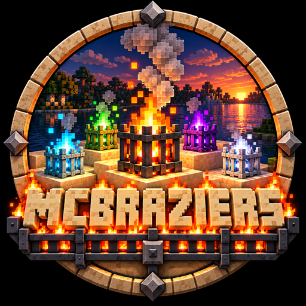
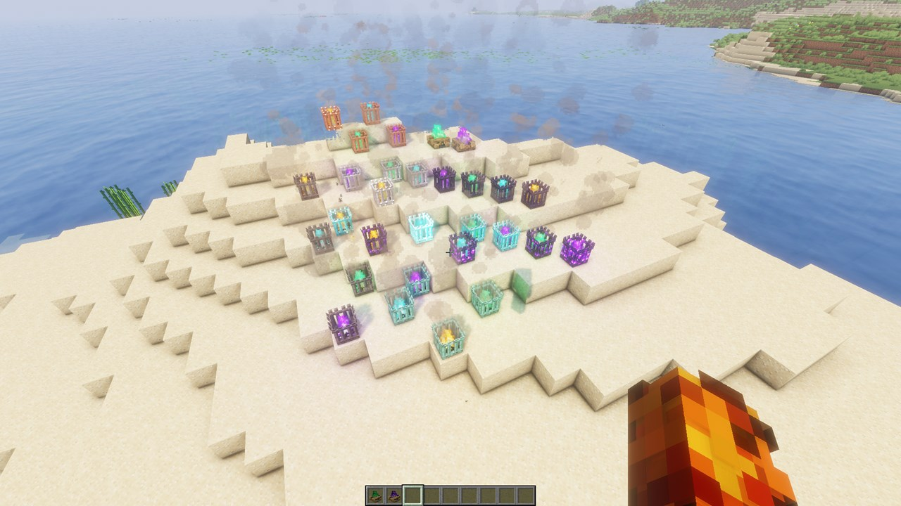
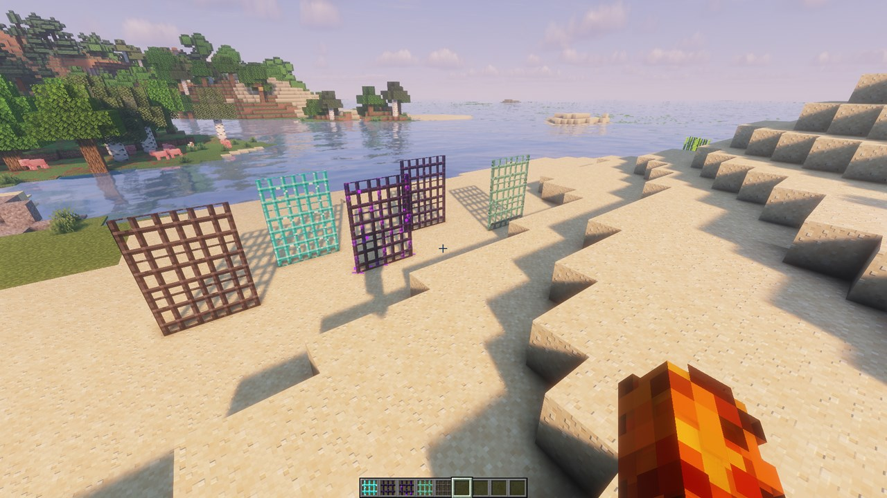
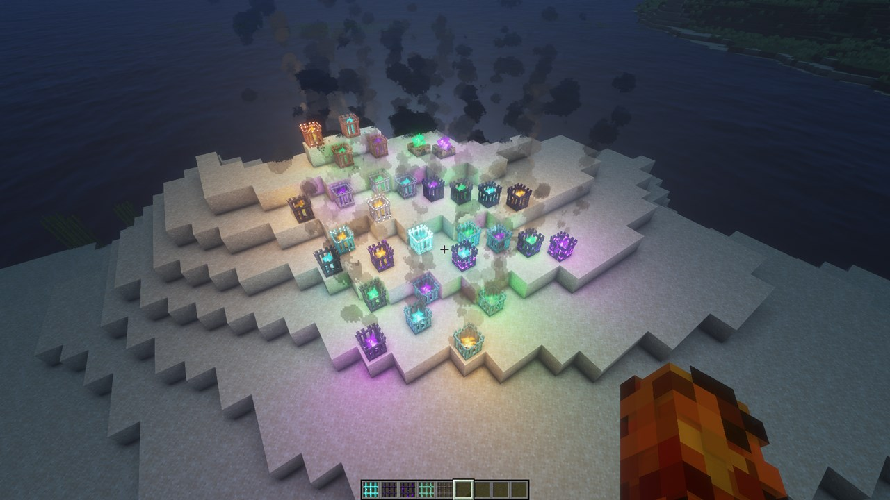
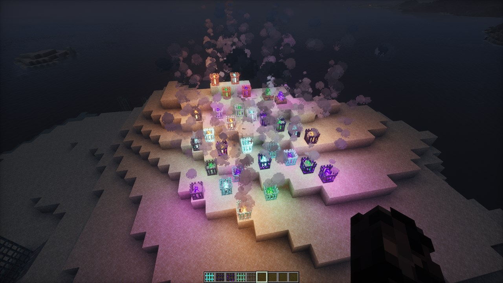

<p align="center">
  
</p>

# MC Braziers

A Fabric mod for Minecraft that adds metal braziers in a vanilla+ style. A brazier is a campfire held
in a cage of bars: the bars set its **tier**, and the campfire sets its **fire type**. Braziers stand on
the floor, mount on walls, or hang from chains and ceilings. They cook food, light your builds, and join
up into fire pits.

**NOT AN OFFICIAL MINECRAFT PRODUCT. NOT APPROVED BY OR ASSOCIATED WITH MOJANG OR MICROSOFT.**

## Requirements

| You need | Version |
|---|---|
| Minecraft: Java Edition | 26.3 |
| [Fabric Loader](https://fabricmc.net/use/installer/) | 0.19.5 or newer |
| [Fabric API](https://modrinth.com/mod/fabric-api) | the 26.3 version (built against 0.163.0+26.3) |
| Java | 25 (the official Minecraft launcher supplies it) |

On a server, install the mod and Fabric API on the server and on every player's game.

## Install

1. Install Fabric Loader for Minecraft 26.3 with the [Fabric installer](https://fabricmc.net/use/installer/).
2. Download Fabric API for 26.3 from [Modrinth](https://modrinth.com/mod/fabric-api) or CurseForge.
3. Download `mcbraziers-1.1.0.jar` from this repository's
   [Releases](https://github.com/DalL337/mcbraziers/releases) page.
4. Put both jars in your `mods` folder (on Windows, `%appdata%\.minecraft\mods`).
5. Start Minecraft with the Fabric profile. The braziers are in their own creative tab.

## What's in it

**Tiers.** Each tier is made from its own bars and has its own perk.

| Tier | Bars | Perk |
|---|---|---|
| Copper | vanilla copper bars | the cheap starting tier; ages like vanilla copper |
| Iron | vanilla iron bars | cooks 1.25× faster |
| Diamond | diamond bars | cooks 1.5× faster |
| Obsidian | obsidian or crying obsidian bars | cooks 1.5× faster; explosion-proof |
| Prismarine | prismarine bars | cooks 1.5× faster; stays lit in water and can be lit underwater |
| Netherite | netherite bars | cooks 2× faster; explosion-proof and water-proof; the item survives lava |

**Fire types.** The campfire you craft with sets the colour and the light level.

| Fire | Campfire | Light |
|---|---|---|
| Orange | Campfire | 15 |
| Green | Copper Campfire (new) | 14 |
| Purple | Amethyst Campfire (new) | 12 |
| Blue | Soul Campfire | 10 |

**Also:**

- Floor braziers have a grate you open and close with an empty hand. Wall and hanging braziers are
  always closed. Closed braziers cook like campfires, up to 4 items at once. Open ones burn anything
  that steps in.
- Floor braziers side by side join into one fire pit. Wall braziers in a row on the same wall join up
  too, and the row turns where two walls meet. It also wraps round a block's outside corner when both
  faces have wall braziers.
- Click a brazier with a brazier in hand to grow its fire pit. The side of a floor brazier adds one
  beside it. The end or the front of a wall brazier adds the next one along the wall, or straight on
  past where the wall ends. Sneak-click to place against the clicked face instead.
- Copper braziers age through four stages. Wax them with honeycomb, and scrape them with an axe.
- Diamond, obsidian, crying obsidian, prismarine and netherite bars are placeable blocks that connect
  like iron bars.
- Water puts out most braziers. Sneak-click with an empty hand turns any brazier off, and
  `/brazier extinguish` toggles the one you're looking at.

**Crafting:** surround any campfire with 8 bars of the tier you want. New bars are 8 iron bars around
1 diamond, obsidian, crying obsidian or prismarine crystals; netherite bars are 8 diamond bars around
1 netherite ingot. The new campfires are crafted like a campfire, with a copper nugget or an amethyst
shard in place of the coal.

## Screenshots

<table>
  <tr>
    <td width="50%"></td>
    <td width="50%"></td>
  </tr>
  <tr>
    <td>Every tier and fire type, with the Copper and Amethyst Campfires at the back.</td>
    <td>The placeable bars: netherite, diamond, crying obsidian, obsidian and prismarine.</td>
  </tr>
  <tr>
    <td></td>
    <td></td>
  </tr>
  <tr>
    <td>At night with Solas: each fire lights the sand in its own colour.*</td>
    <td>At night with Photon, with its Colored Lights setting on.*</td>
  </tr>
</table>

The screenshots use the Solas and Photon shader packs. \*Coloured light from braziers needs MC Braziers
support in the shader pack itself, which is waiting to be merged in
[Solas](https://github.com/Septonious/Solas-Shader/pull/206) and
[Photon](https://github.com/sixthsurge/photon/pull/692).

## Build from source

You need a JDK 25 installed (CI uses Eclipse Temurin 25). The Gradle wrapper downloads Gradle and
the Minecraft and Fabric dependencies. It won't download a JDK: if Gradle can't find Java 25, set
`JAVA_HOME` to your JDK 25 folder.

```sh
git clone https://github.com/DalL337/mcbraziers.git
cd mcbraziers
./gradlew build        # on Windows: gradlew build
```

The mod is `build/libs/mcbraziers-1.1.0.jar` (the `-sources` jar is the source code). The build also
runs the unit tests and the headless game tests. `./gradlew runClient` starts a development game with
the mod loaded.

The full design is in [docs/prds/mcbraziers-1.0.md](docs/prds/mcbraziers-1.0.md), and the stack and
its versions are in [docs/TOOLING.md](docs/TOOLING.md).

## License

MC Braziers is released under the [MIT License](LICENSE).

Minecraft and its assets belong to Mojang. The mod ships no Mojang files: its textures are original,
and the green and purple flames are the game's own soul campfire flame, tinted or recoloured by the
game from your copy of Minecraft.
